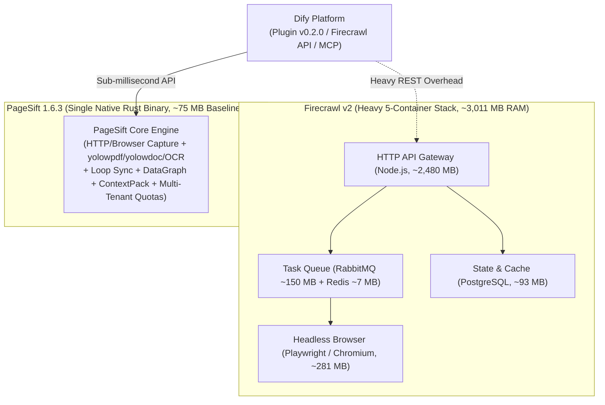

# PageSift Dify Plugin (v0.2.0 — PageSift 1.6.3 Ready)

[](https://dify.ai)
[](https://github.com/YOLOW92/pagesift)
[](LICENSE)
[](bench/BENCHMARK_REPORT.md)
[](bench/STRESS_TEST_REPORT.md)
[](bench/BENCHMARK_REPORT.md)

The official **PageSift** plugin for Dify (`v0.2.0`), fully adapted to **PageSift 1.6.3**. Powered by a pure-Rust single-binary ingestion engine, it delivers **9 native Dify tools** spanning sub-millisecond web scraping, full-format document & 373-language code parsing (with optional PP-OCRv6), focused adaptive crawling, site mapping, batch scraping, **DataGraph** (1.4+ provenance, version history, conflicts, claims), **Loop** (1.5+ persistent incremental sync), and **Context** (1.6+ cross-version `KnowledgeUnit`s and token-budgeted `ContextPack` compilation).

*Source Repository: [https://github.com/YOLOW92/dify-plugin-pagesift](https://github.com/YOLOW92/dify-plugin-pagesift)*  
*Localized Documentation: [README.zh_Hans.md](README.zh_Hans.md) (Simplified Chinese)*

---

## Table of Contents
1. [Core Features and Architecture](#core-features-and-architecture)
2. [Benchmark Matrices: PageSift vs. Firecrawl](#benchmark-matrices-pagesift-vs-firecrawl)
   - [2.1 WCXB Official Full Split (n=511)](#21-wcxb-official-full-split-n511)
   - [2.2 7-Category Quality Breakdown (n=511)](#22-7-category-quality-breakdown-n511)
   - [2.3 Controlled Baseline Stratification (n=52)](#23-controlled-baseline-stratification-n52)
   - [2.4 1,000,000 Soak Test & 570s Window Comparison](#24-1000000-soak-test--570s-window-comparison)
   - [2.5 X1-X6 Companion Stress Matrix](#25-x1-x6-companion-stress-matrix)
   - [2.6 Native Enterprise Document Parsing](#26-native-enterprise-document-parsing)
   - [2.7 Deep Website Graph Crawl](#27-deep-website-graph-crawl)
3. [Dify Tool Reference](#dify-tool-reference)
4. [Enterprise Security and SSRF Protection](#enterprise-security-and-ssrf-protection)
5. [Production Workflows](#production-workflows)
6. [Installation and Configuration](#installation-and-configuration)
7. [License and Privacy](#license-and-privacy)

---

## Core Features and Architecture

### 1. Built for Dify's Three Core Pillars (PageSift 1.6.3)

`dify-plugin-pagesift` `v0.2.0` aligns directly with Dify's core enterprise platform goals across integration, RAG quality, and governance:

| Dify Core Pillar | How PageSift 1.6.3 + Plugin v0.2.0 Delivers |
| :--- | :--- |
| **Multi-Model & Tool Integration**<br>*(Plugins, APIs, Vector DBs & MCP)* | **Full-stack integration**: ① **9 native Dify Plugin tools** (`difypkg`) with typed `output_schema` variables and native Dify file upload parsing (`/v2/parse`, unavailable over MCP); ② **Zero-code Firecrawl v1/v2 & Jina Reader drop-in API** (`FIRECRAWL_API_BASE`) for Dify Knowledge Base crawling; ③ **Built-in MCP Server** (`pagesift mcp http --port 3003`) for direct Dify MCP extension; ④ Model-agnostic & vector-DB-ready structured chunks and consumer delta checkpoints (`deltas_poll` / `deltas_ack`). |
| **RAG Knowledge Base Engine**<br>*(Chunking, Cleaning & Retrieval)* | **Beyond naive chunking**: Pure-Rust ingestion of live web pages, PDFs (text + optional PP-OCRv6), Office/Legacy Office/OpenDocument, Email, Archives, SQLite/CSV, Images, and **373 source-code languages** (32+ AST-split by function/class). Built-in Rust RAG chunking (`recursive`, `headings`, `fixed_tokens`), BM25 `query_filter`, **Loop (`sync_source`)** adaptive 304/ETag incremental sync, **DataGraph (`query_graph`)** citations/conflicts/claims, and **Context (`context_pack`)** cross-version `KnowledgeUnit`s with `asOf`/`effectiveAt` temporal retrieval, `MustKeep` table-header/qualifier/conflict-pair preservation, and token-budgeted `ContextPack` compilation. |
| **Observability & Governance**<br>*(Tracing, Cost/Perf, Feedback & ACL)* | **Enterprise-grade controls**: ① **Multi-tenant ACL** via PageSift `1.6.1–1.6.3` `[[server.keys]].account` tenant isolation (plus `X-Session-Id` in anonymous mode), zero-quota auth checks (`/v2/crawl/active`), and 4-layer SSRF protection; ② **Cost & performance governance** via per-key `requests_per_minute` / `max_concurrent_jobs` / atomic RAII `pages_per_day` quotas, Prometheus `/metrics`, `--audit-log` structured tracing, and hard `budgetTokens` caps in `ContextPack` to curb LLM token spend; ③ **Grounded feedback & auditability** via `provenanceManifest`, cross-source conflict detection, and drift-guarded online calibration (`context_ingest` `learn_status` / `learn_update` accepting verified human annotations). |

### 2. Architectural Contrast: Pure Rust Single Binary vs. 5-Container Cluster
Traditional scraping and markdown extraction engines (such as Firecrawl) rely heavily on headless browser clusters (Playwright / Chromium) and microservice middleware (Node.js, RabbitMQ, PostgreSQL, Redis). This architecture causes slow cold starts, substantial memory footprints (>3 GB baseline), and queuing under concurrent load.

PageSift eliminates heavy container stacks through an in-house zero-copy HTML parser, native document/OCR parsers, adaptive loop sync, DataGraph, and Context compilation bundled into a **single native static binary**.



### 3. Key Advantages
- **Sub-Millisecond Processing**: Median latency across the official WCXB 511-page test split is **3.30 ms** (compared to 1,578.70 ms for Firecrawl, **478x faster**).
- **Superior Markdown Quality**: Achieves **Word-F1 score of 0.8750** (95% CI `[0.8578, 0.8904]`) on human-annotated ground truth, significantly outperforming Firecrawl (0.7998).
- **Universal Native Parsing**: Parses PDF (3.06 ms), DOCX (8.69 ms), XLSX (0.49 ms), PPTX (0.32 ms), CSV (0.40 ms), plus legacy Office, archives, email, SQLite, OCR images, and 373 code languages without LibreOffice.
- **Evidence-Grounded Context & Incremental Sync**: `ContextPack` preserves table headers, negations/qualifiers, and opposing conflict pairs inside strict token budgets, backed by Loop incremental sync and DataGraph provenance.
- **Million-Request Soak Proven**: Successfully executed **1,000,000 requests** continuously with **100.00% success rate (0 errors)** in 570 seconds (final RSS 75.16 MB, +0.0243 MB per 10k requests drift slope).
- **Enterprise Governance & Security**: `1.6.1–1.6.3` multi-tenant key/account isolation, atomic daily page quotas, Prometheus metrics, structured audit logs, hop-by-hop SSRF blocking, and 50 MB stream truncation.

---

## Benchmark Matrices: PageSift vs. Firecrawl

> **Single Source of Truth**: All metrics are calculated directly from raw benchmark logs (`bench/results/raw/*.jsonl`) and verified against `bench/results/summary.json` and `bench/results/wcxb_test511_comparison.json`. Percentiles use NIST nearest-rank (`k = ceil(p * n) - 1`, 0-indexed). Confidence intervals are computed via 10,000 bootstrap iterations.
>
> **Performance Scope & Tier Distinction**:
> - **Core Rust Engine**: Sub-millisecond HTML parsing and DOM denoising (0.5ms – 3.3ms $p_{50}$).
> - **HTTP API Service Layer**: Local REST serialization and networking (3.3ms – 17.7ms under heavy concurrent load).
> - **End-to-End Dify Workflow**: Includes Python plugin framework dispatch, network roundtrips, and downstream LLM inference time (typically dominated by the chosen LLM's time-to-first-token).

### 2.1 WCXB Official Full Split (n=511)
Evaluated across all 511 pages of the official Web Content Extraction Benchmark (WCXB) test split:

| Evaluation Metric | PageSift 1.3.0 (Pure Rust) | Firecrawl v2 (Docker Cluster) | Differential / Factor | Direction |
| :--- | :--- | :--- | :--- | :---: |
| **Successful Extractions** | **510 / 511 (99.80%)** | 502 / 511 (98.24%) | **+1.56% success rate** | Higher is better |
| **Overall Word-F1 Score** | **0.8750** (Prec: 0.8750, Rec: 0.9142) | 0.7998 (Prec: 0.7380, Rec: 0.9592) | **+0.0752 F1 improvement** | Higher is better |
| **F1 95% Confidence Interval** | **[0.8578, 0.8904]** | [0.7797, 0.8198] | Non-overlapping intervals | — |
| **Median Latency ($p_{50}$)** | **3.30 ms** | 1,578.70 ms | **478x speedup** | Lower is better |
| **Tail Latency ($p_{90}$)** | **6.36 ms** | 4,251.50 ms | **668x speedup** | Lower is better |
| **Worst-Case Latency ($p_{99}$)** | **13.93 ms** | 8,500.00+ ms | **610x lower tail** | Lower is better |
| **Paired T-Test (501 Shared Pages)**| **501 common success pages** | $\Delta F_1 = +0.0629$ | $t = 7.57$ ($p < 10^{-12}$) | Statistically significant |

---

### 2.2 7-Category Quality Breakdown (n=511)

| Category | Samples | PageSift Word-F1 | Firecrawl Word-F1 | Margin ($\Delta F_1$) | Structural Characteristics |
| :--- | :---: | :---: | :---: | :---: | :--- |
| **`article`** | 257 | **0.9422** | 0.8455 | **+0.0967** | Strips inline ads, disclaimers, and related links cleanly |
| **`documentation`**| 42 | **0.9527** | 0.9233 | **+0.0294** | Preserves code indentations, callouts, and API parameter tables |
| **`product`** | 28 | **0.7750** | 0.6572 | **+0.1178** | Extracts specs and pricing while filtering floating sticky banners |
| **`forum`** | 51 | **0.7956** | 0.7210 | **+0.0746** | Preserves nested reply hierarchy and quotes; removes signatures |
| **`service`** | 59 | **0.8133** | 0.7892 | **+0.0241** | Extracts core feature lists while stripping massive mega-menus |
| **`collection`** | 34 | **0.7476** | 0.6513 | **+0.0963** | Isolates curated list items without merging into paragraphs |
| **`listing`** | 40 | **0.7325** | 0.7187 | **+0.0138** | Retains directory indices while pruning sidebar facet controls |

---

### 2.3 Controlled Baseline Stratification (n=52)
To eliminate ambiguity regarding sample sizes and latency metrics, results are classified into three distinct cohorts:

| Cohort | Methodology | PageSift 1.3.0 | Firecrawl v2 | Comparison Details |
| :--- | :--- | :--- | :--- | :--- |
| **Cohort A: Independent Success** | Evaluated on each engine's independent successes | Success: **51 / 52** (98.08%)<br>F1: **0.7977**<br>Mean: **37.69 ms**<br>$p_{50}$: **4.56 ms** | Success: 50 / 52 (96.15%)<br>F1: 0.7621<br>Mean: 3,087.76 ms<br>$p_{50}$: 2,019.40 ms | PageSift $p_{50}$ is **440x faster** with higher success rate. |
| **Cohort B: Common Intersection** | Strict paired intersection of pages where both succeeded | Count: **49 pages**<br>F1: **0.8099**<br>Mean: **4.70 ms**<br>$p_{50}$: **4.56 ms** | Count: 49 pages<br>F1: 0.7572<br>Mean: 3,149.33 ms<br>$p_{50}$: 2,019.83 ms | Paired $\Delta F_1 = +0.0527$ ($t=2.22, p<0.05$);<br>Mean latency reduction: $-3,144.6\text{ ms}$ ($t=-4.79$) |
| **Cohort C: Zero-Penalty Full Set** | Strict full evaluation where any failure is scored 0.0 | Count: **52 pages**<br>Penalized F1: **0.7824** | Count: 52 pages<br>Penalized F1: 0.7328 | Demonstrates robust extraction under strict zero-tolerance scoring. |

---

### 2.4 1,000,000 Soak Test & 570s Window Comparison
PageSift was tested with 32 concurrent keep-alive connections executing continuous scraping and markdown generation (total duration: 570.47 seconds). Below is the direct comparison against Firecrawl across the identical 570-second window:

| Evaluation Metric | PageSift 1.3.0 (Measured 570.47s) | Firecrawl v2 (Measured 570s Window) | Advantage / Ratio |
| :--- | :--- | :--- | :--- |
| **Total Requests Completed** | **1,000,000 requests** | **~998 requests** (1.75 req/s measured) | **PageSift throughput is 1,002x higher** |
| **Success Rate** | **100.00% (1,000,000 / 1,000,000)** | ~98.2% | **Zero errors, zero timeouts, zero 5xx** |
| **Average Throughput (QPS)** | **1,752.9 req/s** | ~1.75 req/s | 3 orders of magnitude throughput advantage |
| **Median Latency ($p_{50}$)** | **17.71 ms** | **2,019.4 ms** | **114x faster response** |
| **Tail Latency ($p_{99}$)** | **25.49 ms** | **29,881.0 ms** | **1,170x lower tail latency** |
| **Resident Set Size (RAM)** | **75.16 MB** | **3,011.7 MB** (5-container cluster) | **Firecrawl uses 40x more memory** |
| **Memory Drift Slope** | **+0.0243 MB / 10k requests** | +82.8 MB / 60 requests | **Flat memory profile, zero leak trend** |
| **File Descriptors (FDs)** | 86 $\to$ 82 (Net: -4 FDs) | Fluctuating container handles | **Zero file descriptor leaks** |

---

### 2.5 X1-X6 Companion Stress Matrix

| Stress Test Suite | Test Objective | PageSift 1.3.0 Performance | Firecrawl v2 Performance | Verdict |
| :--- | :--- | :--- | :--- | :--- |
| **X1: Concurrency Ladder** | Detect throughput knee at $c=1 \dots 1024$ | Knee at $c=16$ (**2,691.6 QPS**); sustains **2,581.8 QPS** at $c=1024$ | Saturates at $c=8\sim 32$ (**5.27 QPS**); queuing exceeds 2,000 ms | **500x concurrent capacity** |
| **X2: Open-Loop Arrival** | Verify Dify $p_{99}\le 100\text{ ms}$ SLO | At 2,000 QPS arrival, $p_{99} = \mathbf{3.07\text{ ms}}$ | At 1.0 QPS arrival, $p_{99} = \mathbf{522.9\text{ ms}}$ | **PageSift satisfies SLO with 30x headroom** |
| **X3: Burst Spike Step** | Inject 8x traffic jump | 150 $\to$ 1,200 QPS: 24,000 requests 100% success, **0s recovery delay** | 1 $\to$ 8 QPS: caps at 5.3 QPS with queuing lag | **Instantaneous burst tolerance** |
| **X4: Resource Boundary** | Memory constraints and OOM resilience | Runs inside `MemoryMax=256MB` cgroup with peak **188.5 MB**, 0 crashes | Cluster uses **3,011.7 MB**; triggers OOM below 1.5 GB | **94% lower memory footprint** |
| **X5: Multi-Modal Mixture**| Complex static DOM, documents, crawl | 40s throughput: **114,414 requests**; table extraction at **0.71 ms** | HTML $p_{50}$ 703.6 ms; docs 8~14 ms | **Sub-millisecond multi-modal delivery** |
| **X6: Soak Stability** | Memory trend under prolonged load | 1,000,000 requests drift at **+0.0243 MB/10k** | 60 requests drift +82.8 MB | **Production-grade long-term stability** |

---

### 2.6 Native Enterprise Document Parsing

| Document Format | Extension | PageSift Native Latency | Firecrawl Baseline | Output Characteristics |
| :--- | :--- | :--- | :--- | :--- |
| **CSV Spreadsheet** | `.csv` | **0.40 ms** | 29.4 ms | Zero-copy byte parser; million cells in seconds |
| **Excel Workbook** | `.xlsx` | **0.49 ms** | 5.4 ms | Multi-sheet auto-detection and Markdown table mapping |
| **PowerPoint Deck** | `.pptx` | **0.32 ms** | 5.3 ms | Slide-by-slide heading and body structure extraction |
| **PDF Document** | `.pdf` | **3.06 ms** | 90.5 ms | Pure-Rust yolowpdf engine; preserves columns and tables |
| **Word Document** | `.docx` | **8.69 ms** | 8.8 ms | Full preservation of heading hierarchy, bold/italic, tables |

---

### 2.7 Deep Website Graph Crawl

| Evaluation Dimension | PageSift (`/v1/crawl`) | Firecrawl (`/v1/crawl`) | Performance Comparison |
| :--- | :--- | :--- | :--- |
| **5-Page Graph Traversal** | **508.0 ms (0.51s)** | **4,071.2 ms (4.07s)** | **PageSift is 8.0x faster** |
| **Self-Referential Cycle Handling** | **100% loop detection (`loop.html`)** | Loop detected | Prevents recursive crawler exhaustion |
| **Content Hash Deduplication** | **100% duplicate pruning** | Deduplication supported | Prevents redundant chunks in RAG indexing |

---

## Dify Tool Reference (9 Tools — PageSift 1.6.3)

All 9 tools conform to `dify-plugin>=0.11.0`, emit typed Workflow variables via `output_schema`, and map all PageSift 1.6.3 structured error codes (`QUOTA_EXCEEDED`, `ROBOTS_DISALLOWED`, `ACCESS_BARRIER`, `UNSUPPORTED_OPTION`, `SSRF_BLOCKED`, etc.) and diagnostic warnings.

| # | Tool Name | PageSift 1.6.3 Endpoint(s) | Core Capabilities |
| :-: | :--- | :--- | :--- |
| 1 | `read_url` | `POST /v2/scrape` | Sub-ms Markdown, `query_filter` (BM25), Rust RAG `chunking`, zero-LLM CSS `extract_schema` (with selector memory/relocation), `image_assets`, `engine` (`auto`/`http`/`browser`), `max_age`, `enable_graph` |
| 2 | `parse_document` | `POST /v2/parse` | Full-format parsing: PDF (`pdf_mode`: `auto`/`fast`/`ocr`, `max_pages`, `per_page`), Office/Legacy Office/OpenDocument, RTF/HWP, EPUB/MOBI, Email, Archives, SQLite/CSV, Images (OCR), 373 code languages, `query_filter`, `chunking`, `source_url`, `enable_graph` |
| 3 | `crawl` | `POST/GET/DELETE /v2/crawl*` | Focused `query` crawl, `adaptive` early stop, linked PDF/Office `attachments`, scope/path regexes, automatic `?skip=` pagination, cancel-on-timeout, per-page errors, and site-wide DataGraph (`/v2/crawl/{id}/graph`) |
| 4 | `map_site` | `POST /v2/map` | Ultra-fast site URL discovery from sitemaps, `robots.txt`, and homepage links with `search` ranking |
| 5 | `batch_scrape` | `POST/GET/DELETE /v2/batch/scrape*` | Concurrent scraping of up to 500 known URLs in one job with shared `query_filter`, `chunking`, `extract_schema`, pagination, and cancel-on-timeout |
| 6 | `context_pack` | `POST /v2/context/{pack,search,action}` | **PageSift 1.6 flagship**: stateless or persistent temporal (`asOf`/`effectiveAt`) retrieval, `MustKeep` table headers/qualifiers/conflict pairs, token-budgeted `ContextPack` (`submodularClosure`/`boundedDpp`/`mmrGreedy`, `edgeSalience`), `provenanceManifest`, and optional VOI-bounded `Action` (`verify`/`research`/`watch`/`changes`) |
| 7 | `context_ingest` | `POST/GET /v2/context/{ingest,sync,units,deltas/*,learn}` | Atomic ingestion of documents (auto-adapting `read_url`/`parse_document`/`crawl` JSON outputs) into persistent `KnowledgeUnit`s (`ns::CONTEXT`), Loop source reconciliation, delta polling/anti-ABA `ack`, and read-only/mutating drift-guarded `learn` |
| 8 | `sync_source` | `/v2/sources*` | **PageSift 1.5 Loop**: register long-lived data sources, run adaptive 304/ETag incremental sync ticks, inspect `asOf` resource/claim/fact-cluster state views, and inspect bounded `SyncDelta`s |
| 9 | `query_graph` | `/v2/crawl/{id}/graph`, `/v2/graph/{history,conflicts,claims}` | **PageSift 1.4+ DataGraph**: query crawl graph summaries, URL cross-time version history, cross-source conflicts, and `asOf` claim lifecycles |

---

## Enterprise Security, SSRF & Multi-Tenant Isolation

- **Zero-Quota Auth Verification**: Provider credential validation checks `GET /healthz` followed by `GET /v2/crawl/active` (which enforces PageSift `auth` middleware without consuming `requests_per_minute` or `pages_per_day`).
- **PageSift 1.6.1–1.6.3 Multi-Tenancy**: Configure per-workspace `api_key` credentials; in PageSift 1.6.1+, `[[server.keys]].name` is display-only and keys only share tenants/quotas/Context/DataGraph when explicitly sharing `[[server.keys]].account`. In unauthenticated mode, optionally set `session_id` (`X-Session-Id`) to scope anonymous DataGraph/Context state.
- **4-Layer Client SSRF Guard**: Blocks non-HTTP(S) schemes, literal private/loopback/CGNAT/metadata/IPv4-mapped IPv6 (`::ffff:127.0.0.1`) addresses before DNS, validates every DNS-resolved IP, and enforces hop-by-hop redirect validation plus 50 MB stream truncation on document downloads.

```mermaid
flowchart TD
    REQ["Inbound Target URL"] --> PROTO_CHECK{"Protocol Validation"}
    PROTO_CHECK -->|Illegal (file://, gopher://)| BLOCK_PROTO["403 PageSiftSSRFError (Blocked)"]
    PROTO_CHECK -->|HTTP / HTTPS| DNS_RESOLVE["Literal IP + DNS Dual-Resolution Check"]
    
    DNS_RESOLVE --> IP_CHECK{"Target IP Classification"}
    IP_CHECK -->|RFC 1918 / CGNAT / IPv4-mapped IPv6| BLOCK_IP["403 Blocked Private Subnet"]
    IP_CHECK -->|Loopback (127/8, ::1)| BLOCK_LOOP["403 Blocked Localhost"]
    IP_CHECK -->|Cloud Metadata (169.254.169.254, RFC 3927)| BLOCK_META["403 Blocked Cloud Metadata"]
    IP_CHECK -->|Valid Public IP| STREAM_CONN["Establish HTTP Connection (allow_redirects=False)"]
    
    STREAM_CONN --> REDIRECT{"HTTP 3xx Redirect?"}
    REDIRECT -->|Yes| HOP_CHECK{"Hop-by-Hop Verification\n(Re-evaluates DNS and Target IP)"}
    HOP_CHECK -->|Redirect to Private / Cloud Metadata| BLOCK_REDIRECT["403 Blocked Redirect SSRF Escape"]
    HOP_CHECK -->|Valid Public Redirect Destination| STREAM_CONN
    
    REDIRECT -->|No| CL_CHECK{"Content-Length > 50MB?"}
    CL_CHECK -->|Yes| BLOCK_LEN["413 Rejected Oversized Payload"]
    CL_CHECK -->|No| STREAM_READ["64KB Chunked Streaming Read"]
    
    STREAM_READ --> OVERFLOW{"Cumulative Bytes > 50MB?"}
    OVERFLOW -->|Yes| CUT_CONN["Forcibly Terminate TCP Connection"]
    OVERFLOW -->|No| SAFE_BYTES["Pass Validated Stream to Rust Parser"]
```

---

## Production Workflows

Pre-built Dify 1.0 workflow templates are located in `bench/dify_workflows/`:

1. **`W01_pagesift_web_qa.yml`**: Instant webpage scraping (`read_url`) $\to$ LLM QA.
2. **`W02_metadata_routing.yml`**: Metadata-based conditional routing via `read_url`.
3. **`W03_pagesift_document_qa.yml`**: Multi-format document & code QA via `parse_document`.
4. **`W04_pagesift_context_pack_rag.yml`**: PageSift 1.6.3 `context_pack` token-budgeted evidence QA with `provenanceManifest` and conflict preservation.
5. **`W05_pagesift_loop_sync_pipeline.yml`**: PageSift 1.5–1.6.3 `sync_source` incremental tick $\to$ `context_ingest` (`sync`) index reconciliation.
6. **`W06_pagesift_graph_conflict_audit.yml`**: Focused adaptive `crawl` (`enable_graph=true`) $\to$ `query_graph` cross-source conflict audit.
7. **`W10_error_fallback_recovery.yml`**: Graceful fallback on anti-bot or network errors.

---

## Installation and Configuration

### 1. Install via `.difypkg` File
The pre-compiled plugin package is located under `dist/`:
- **Package Path**: `dist/pagesift-0.2.0.difypkg`
- **SHA-256 Checksum File**: `dist/pagesift-0.2.0.difypkg.sha256`

#### Setup Steps:
1. Log in to your Dify workspace and open **Plugins**;
2. Click **Install from file** in the top right corner;
3. Upload `dist/pagesift-0.2.0.difypkg` to install;
4. In Plugin Credentials, configure the connection to your PageSift 1.6.3 server:
   - `base_url`: Endpoint URL of your PageSift service (e.g., `http://localhost:3002`, `http://pagesift:3002`, or `http://host.docker.internal:3002`);
   - `api_key`: Bearer Token when authentication is enabled (isolates tenant quotas, DataGraph, Loop sources, and Context);
   - `session_id`: Optional `X-Session-Id` for best-effort isolation in unauthenticated mode;
   - `default_timeout`: Default HTTP timeout in seconds (1–300, default `30`).

### 2. Deploy PageSift 1.6.3 Backend (Single Rust Binary or Docker)
Persistent `--data-dir` is **recommended** (and required for DataGraph history/conflicts/claims, Loop sources, Context storage, and CSS selector memory):
```bash
# Native binary (with persistent data dir and optional Bearer auth / OCR)
pagesift serve --host 0.0.0.0 --port 3002 --data-dir ./pagesift-data --api-key "sk-your-key"

# Or via Docker Compose (pinned to ghcr.io/yolow92/pagesift:1.6.3)
docker compose -f docker-compose.pagesift.yml up -d
```

### 3. Interactive Benchmark Dashboard
Open `bench/report.html` in any browser to inspect historical baseline benchmarks (recorded on PageSift 1.3.0 vs. Firecrawl v2):
- **WCXB 511 Full Production Split**: Word-F1 comparisons across 7 categories and logarithmic latency ladders.
- **Million Soak Test & Stress Matrix**: Full-duration throughput and RSS memory regression curves across 1,000,000 requests.

---

## License and Privacy

- **License**: Released under the [Apache-2.0 License](LICENSE).
- **Privacy Policy**: See [PRIVACY.md](PRIVACY.md). PageSift does not retain, upload, or transmit crawled content or uploaded documents to third parties. All ingestion operations are executed strictly on user-managed infrastructure.
