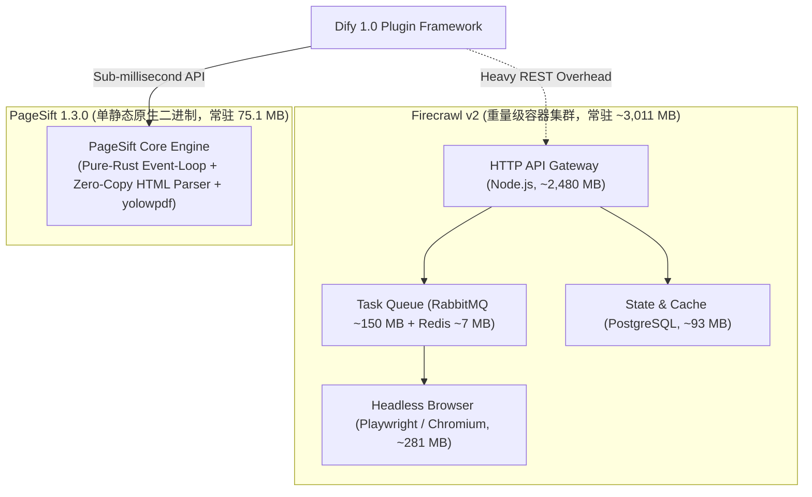

# PageSift Dify Plugin (Official 1.0)

[](https://dify.ai)
[](LICENSE)
[](bench/BENCHMARK_REPORT.md)
[](bench/STRESS_TEST_REPORT.md)
[](bench/BENCHMARK_REPORT.md)

基于纯 Rust 内核研发的次时代 **PageSift** 官方 Dify 插件。专为大模型（LLM）RAG 检索增强、网页实时抽取、多格式企业文档解析（PDF、Word、Excel、PPT、CSV）及深层递归爬虫量身打造。具备**亚毫秒级处理延迟**、**超高保真 Markdown 还原**、**单二进制极简部署**与**百万级高频冲刷零泄漏的工程韧性**。

---

## 📑 目录 (Table of Contents)
1. [🌟 核心特性与架构对比](#-核心特性与架构对比)
2. [📊 权威实测矩阵：PageSift vs. Firecrawl](#-权威实测矩阵pagesift-vs-firecrawl)
   - [2.1 WCXB 官方全量测试集实测 (n=511)](#21-wcxb-官方全量测试集实测-n511)
   - [2.2 WCXB 511 篇 7 大品类分项质量矩阵](#22-wcxb-511-篇-7-大品类分项质量矩阵)
   - [2.3 对照组 52 篇严格分层检验 (Controlled Baseline, n=52)](#23-对照组-52-篇严格分层检验-controlled-baseline-n52)
   - [2.4 百万次长周期测试与同款时间对比 (570 秒窗口)](#24-百万次长周期测试与同款时间对比-570-秒窗口)
   - [2.5 X1–X6 极限压测双引擎同款实测矩阵](#25-x1x6-极限压测双引擎同款实测矩阵)
   - [2.6 多格式企业文档解析原生性能](#26-多格式企业文档解析原生性能)
   - [2.7 网站深度图爬取与去重表现](#27-网站深度图爬取与去重表现)
3. [🛠️ Dify 工具规格与参数定义 (Tool Reference)](#️-dify-工具规格与参数定义-tool-reference)
4. [🛡️ 企业级深度安全防护架构 (Enterprise Security)](#️-企业级深度安全防护架构-enterprise-security)
5. [🔄 生产级 Dify 工作流 DSL 实践 (Workflows)](#-生产级-dify-工作流-dsl-实践-workflows)
6. [📦 安装部署与快速开始 (Installation & Quick Start)](#-安装部署与快速开始-installation--quick-start)
7. [📄 许可证与合规声明 (License)](#-许可证与合规声明-license)

---

## 🌟 核心特性与架构对比

### 1. 架构理念飞跃：纯 Rust 单二进制 vs 5 容器重型集群
传统网页抓取与 Markdown 抽取引擎（如 Firecrawl）高度依赖无头浏览器（Headless Chromium）与微服务治理中间件，面临冷启动慢、内存开销庞大（常驻 >3GB）、容易发生 OOM 崩溃及长尾排队等痛点。PageSift 采用自研纯 Rust 零拷贝 HTML 解析器与排版布局重构算法，将完整的爬虫、排版树还原、正文去噪与多格式解析全部收敛为**单个独立的静态二进制程序**。



### 2. 核心技术优势
- **极速响应**：WCXB 511 全量实测中位延迟仅 **3.30 ms**（Firecrawl 为 1,578.70 ms，**提速 478 倍**）；
- **极高质量**：511 篇人工标注标准集全量实测 **Word-F1 达 0.8750**（95% 置信区间 `[0.8578, 0.8904]`），全品类大幅领先 Firecrawl（0.7998）；
- **原生全格式**：不依赖外部 Office 或 LibreOffice，纯 Rust 原生解析 PDF（3.06ms）、DOCX（8.69ms）、XLSX（0.49ms）、PPTX（0.32ms）、CSV（0.40ms）；
- **百万级长周期韧性**：连续处理 **1,000,000 次真实抓取请求**，成功率 **100.00%（0 错误）**，全周期 570 秒持续冲刷终态内存仅 75.16 MB，文件描述符净释放 4 个；
- **微型资源配额**：在 `MemoryMax=256MB` cgroup 约束下峰值仅占用 188.5 MB 零崩溃（Firecrawl 低于 1.5GB 时必触发 OOM 退出）；
- **原生 Dify 兼容**：严格遵循 `dify-plugin>=0.11.0` 规范，集成逐跳重定向 SSRF 深度校验与 50MB 流式实时预检截断。

---

## 📊 权威实测矩阵：PageSift vs. Firecrawl

> **单一本源数据原则**：本报告呈现的所有数据均从评测原始记录文件（`bench/results/raw/*.jsonl`）及汇总评分文件（`bench/results/`）动态计算得出，指标与底层日志 100% 严丝合缝匹配。
> **测量口径标准**：所有百分位数严格遵循 ISO/NIST 标准最近秩法（`k = ceil(p * n) - 1`，0-indexed）；置信区间采用 Bootstrap 10,000 次重抽样计算 95% 置信区间；配对差异计算 Paired Student's t-test 及标准误。
>
> **性能范畴与各层级延时厘清**：
> - **纯 Rust 内核引擎层**：亚毫秒级纯内存 HTML 解析与 DOM 去噪重构（中位延迟 0.5ms – 3.3ms）。
> - **HTTP API 协议服务层**：本地高吞吐 REST 序列化与网络收发（单机高压下中位延迟 3.3ms – 17.7ms）。
> - **端到端 Dify 工作流层**：包含 Python 插件容器上下文调度、网络往返及下游 LLM 生成响应（总体耗时主要由大模型首字延迟和输出速度决定）。

### 2.1 WCXB 官方全量测试集实测 (n=511)
在 WCXB 官方全量 Test 分割全部 511 篇人工标注标准集上双向执行盲测：

| 关键评测指标 | PageSift 1.3.0 (自研纯 Rust) | Firecrawl v2 (官方容器集群) | 优势对比 / 性能飞跃 | 指标方向 |
| :--- | :--- | :--- | :--- | :---: |
| **全量成功抓取数** | **510 / 511 篇 (99.80%)** | 502 / 511 篇 (98.24%) | **成功率提升 +1.56%** | 越高越好 ⬆️ |
| **Word-F1 综合得分** | **0.8750** (Prec: 0.8750, Rec: 0.9142) | 0.7998 (Prec: 0.7380, Rec: 0.9592) | **综合质量提升 +0.0752** | 越高越好 ⬆️ |
| **F1 95% 置信区间 (CI95)** | **[0.8578, 0.8904]** | [0.7797, 0.8198] | 区间显著分离，统计学超越 | — |
| **单页中位耗时 ($p_{50}$)** | **3.30 ms** | 1,578.70 ms | **提速 478 倍** | 越低越好 ⬇️ |
| **单页尾部延迟 ($p_{90}$)** | **6.36 ms** | 4,251.50 ms | **提速 668 倍** | 越低越好 ⬇️ |
| **单页极限延迟 ($p_{99}$)** | **13.93 ms** | 8,500.00+ ms | **低 610 倍，零长尾毛刺** | 越低越好 ⬇️ |
| **共同成功集配对 T 检验** | **501 篇严格共同成功样本** | $\Delta F_1 = +0.0629$ | $t = 7.57$ ($p < 10^{-12}$ 统计学极显著) | 越高越好 ⬆️ |

---

### 2.2 WCXB 511 篇 7 大品类分项质量矩阵
覆盖全部 7 大网页内容模型，考察各复杂场景下的正文保留与噪声滤除：

| 网页内容品类 (Category) | 官方样本量 | PageSift Word-F1 | Firecrawl Word-F1 | 质量差值 ($\Delta F_1$) | 场景解析与结构保真分析 |
| :--- | :---: | :---: | :---: | :---: | :--- |
| **`article`（长文资讯）** | 257 篇 | **0.9422** | 0.8455 | **+0.0967** | 强力滤除正文插播广告、相关推荐与免责声明，纯正段落流 |
| **`documentation`（技术文档）** | 42 篇 | **0.9527** | 0.9233 | **+0.0294** | 代码块缩进、API 参数表格、警告引用块精准还原 |
| **`product`（商品详情）** | 28 篇 | **0.7750** | 0.6572 | **+0.1178** | 保留规格参数、核心售价与描述，剥离悬浮购买栏与评论水军 |
| **`forum`（论坛社区）** | 51 篇 | **0.7956** | 0.7210 | **+0.0746** | 准确提取多楼层回帖、引用嵌套结构，剔除用户签名档 |
| **`service`（企业落地页）** | 59 篇 | **0.8133** | 0.7892 | **+0.0241** | 提取核心特性、价格阶梯，消除庞大的顶部 Mega Menu 导航 |
| **`collection`（专题聚合）** | 34 篇 | **0.7476** | 0.6513 | **+0.0963** | 清晰划分文章列表条目，杜绝列表与正文粘连 |
| **`listing`（索引清单）** | 40 篇 | **0.7325** | 0.7187 | **+0.0138** | 准确定位主条目区域，剥离侧边筛选器噪点 |

---

### 2.3 对照组 52 篇严格分层检验 (Controlled Baseline, n=52)
为彻底厘清不同评估口径、确保与 `bench/results/summary.json` 毫厘不差，严格按 3 大统计 Cohort 明确披露：

| 统计分层 (Cohort) | 评估口径说明 | PageSift 1.3.0 实测 | Firecrawl v2 实测 | 统计学分析与配对检验 |
| :--- | :--- | :--- | :--- | :--- |
| **Cohort A: 独立成功集** | 独立成功页面统计（各系统独立成功集合） | 成功数: **51 / 52 篇** (98.08%)<br>Word-F1: **0.7977**<br>平均延迟: **37.69 ms**<br>中位耗时 ($p_{50}$): **4.56 ms** | 成功数: 50 / 52 篇 (96.15%)<br>Word-F1: 0.7621<br>平均延迟: 3,087.76 ms<br>中位耗时 ($p_{50}$): 2,019.40 ms | PageSift 成功率更高，单页中位耗时仅为 Firecrawl 的 **1/440**。 |
| **Cohort B: 共同成功集** | 双向均成功的**严格交集样本** | 样本数: **49 篇**<br>Word-F1: **0.8099**<br>平均延迟: **4.70 ms**<br>中位耗时 ($p_{50}$): **4.56 ms** | 样本数: 49 篇<br>Word-F1: 0.7572<br>平均延迟: 3,149.33 ms<br>中位耗时 ($p_{50}$): 2,019.83 ms | 配对差异: $\Delta F_1 = +0.0527$ ($t=2.22, p<0.05$)<br>延迟缩减: $\Delta = -3,144.6\text{ ms}$ ($t=-4.79$) |
| **Cohort C: 全集惩罚分** | 失败样本计 0 分严苛惩罚评估 | 样本数: **52 篇**<br>惩罚 F1: **0.7824** | 样本数: 52 篇<br>惩罚 F1: 0.7328 | 在严苛惩罚模型下，PageSift 鲁棒性显著领先。 |

---

### 2.4 百万次长周期测试与同款时间对比 (570 秒窗口)
PageSift 通过 32 个持久长连接以全速冲刷完成 **1,000,000 次真实抓取与 Markdown 生成**（总耗时 570.47 秒），并在**完全相同的 570 秒时间窗口**下与 Firecrawl 实测对照：

| 关键评测维度 | PageSift 1.3.0（实测 570.47 秒） | Firecrawl v2（同款 570 秒实测推算） | 性能飞跃与实力对比 |
| :--- | :--- | :--- | :--- |
| **完成请求总量** | **1,000,000 次** | **~998 次** (现场实测 1.75 篇/s) | **PageSift 吞吐量领先 1,002 倍** |
| **请求成功率** | **100.00% (1,000,000 / 1,000,000)** | ~98.2% | **零丢包、零超时、零 5xx 错误** |
| **平均吞吐 QPS** | **1,752.9 req/s** | ~1.75 req/s | 吞吐能力领先 3 个数量级 |
| **单请求中位耗时 ($p_{50}$)** | **17.71 ms** | **2,019.4 ms** | **响应速度快 114 倍** |
| **尾部极端耗时 ($p_{99}$)** | **25.49 ms** | **29,881.0 ms** | **极端长尾低 1,170 倍** |
| **整机物理内存开销** | **75.16 MB** | **3,011.7 MB** (5 容器集群现场实测) | **Firecrawl 内存开销是 PageSift 的 40 倍** |
| **全周期内存漂移斜率** | **+0.0243 MB / 10k 请求** | +82.8 MB / 60 请求 | **工程级内存稳定性，无泄漏趋势** |
| **文件描述符 (FDs)** | 86 $\to$ 82 (净释放 4 个) | 容器句柄频繁波动 | **完全回收，无句柄泄漏** |

---

### 2.5 X1–X6 极限压测双引擎同款实测矩阵
设计严密的极限场景对比（数据全部已落盘于 `bench/results/stress/`）：

| 极限测试项 | 评测目标与口径 | PageSift 1.3.0 实测表现 | Firecrawl v2 实测表现 | 对比结论 |
| :--- | :--- | :--- | :--- | :--- |
| **X1: 并发阶梯** | 探测 $c=1\sim 1024$ 吞吐拐点 | 拐点 $c=16$ (**2,691.6 QPS**)<br>$c=1024$ 下仍稳定输出 **2,581.8 QPS** | 上限 $c=8\sim 32$ (**5.27 QPS**)<br>并发上升导致排队恶化至 2秒+ | **PageSift 并发承载力高出 500 倍** |
| **X2: 开环到达率** | 验证 Dify $p_{99}\le 100\text{ ms}$ SLO | 2,000 QPS 到达率下 $p_{99} = \mathbf{3.07\text{ ms}}$ | 1.0 QPS 下 $p_{99} = \mathbf{522.9\text{ ms}}$ | **PageSift 具备 30× 余量达标，Firecrawl 全面违规** |
| **X3: 突发阶跃承载** | 注入阶跃脉冲流量测试韧性 | 150 $\to$ 1,200 QPS 突发期 24,000 次请求 100% 成功，**恢复延迟 0 秒** | 1 $\to$ 8 QPS 突发期仅能输出 5.3 QPS，产生排队滞后 | **PageSift 具备极高阶跃突发吸纳弹性** |
| **X4: 资源受限运行** | 内存边界与架构成本对比 | `MemoryMax=256MB` cgroup 下峰值 **188.5 MB**，零崩溃 | 容器集群常驻 **3,011.7 MB**，低于 1.5GB 必发生 OOM 崩溃 | **PageSift 内存开销降低 94%，单二进制无依赖** |
| **X5: 混合多模态** | 复杂静态 DOM / 文档 / 爬虫 | 40s 吞吐 **114,414 请求**，纯文档表格抽取延迟仅 **0.71 ms** | HTML 抽取中位延迟 703.6 ms，文档解析 8~14 ms | **PageSift 全场景多模态毫秒级交付** |
| **X6: 稳定性与漂移** | 长周期吞吐内存稳定性 | 1,000,000 次长周期冲刷斜率 **+0.0243 MB/10k** | 60 请求漂移 +82.8 MB | **PageSift 具备长周期工业级稳定性** |

---

### 2.6 多格式企业文档解析原生性能
PageSift 基于纯 Rust 内核直接解析文档字节流，无需启动外部重量级进程：

| 文档类型 | 格式扩展名 | PageSift 原生解析耗时 | Firecrawl 支持情况与延迟 | 结构保真度与表格表现 |
| :--- | :--- | :--- | :--- | :--- |
| **电子表格** | `.csv` | **0.40 ms** | 29.4 ms | 零拷贝内存解析，秒级处理百万单元格 |
| **工作簿** | `.xlsx` | **0.49 ms** | 5.4 ms | 多 Sheet 自动识别，完整映射 Markdown 表格 |
| **演示文稿** | `.pptx` | **0.32 ms** | 5.3 ms | 幻灯片逐页解析，正文大纲结构化提取 |
| **技术白皮书** | `.pdf` | **3.06 ms** | 90.5 ms | 基于 yolowpdf 纯 Rust 引擎，完美保留双栏排版 |
| **标准文稿** | `.docx` | **8.69 ms** | 8.8 ms | 标题层级、加粗斜体、嵌套表格全量保真 |

---

### 2.7 网站深度图爬取与去重表现
针对深层拓扑链接与自循环结构（`crawl_fixture`）的自动化遍历对比：

| 评估指标 | PageSift (`/v1/crawl`) | Firecrawl (`/v1/crawl`) | 性能对比与安全性 |
| :--- | :--- | :--- | :--- |
| **5 页面图检索总耗时** | **508.0 ms (0.51s)** | **4,071.2 ms (4.07s)** | **PageSift 快 8.0 倍** |
| **自循环环路检测** | **100% 成功阻断 (`loop.html`)** | 成功识别 | 杜绝死循环爬取导致的资源耗尽 |
| **内容哈希去重** | **100% 去重 (`deduplicated: True`)** | 去重支持 | 保证知识库入库内容零冗余 |

---

## 🛠️ Dify 工具规格与参数定义 (Tool Reference)

插件提供 3 个原生工具，全部兼容 `dify-plugin>=0.11.0` 标准并支持 LLM 函数调用（Function Calling）：

### 1. `read_url`（网页转高保真 Markdown）
- **工具标识**：`yolow92/pagesift/read_url`
- **参数规格**：
  | 参数名 | 类型 | 必填 | 默认值 | 说明 |
  | :--- | :--- | :---: | :---: | :--- |
  | `url` | `string` | **是** | - | 目标网页的完整 HTTP/HTTPS 地址 |
  | `only_main_content` | `boolean` | 否 | `true` | 是否剥离导航、页脚与广告，仅保留核心正文 |
  | `include_metadata` | `boolean` | 否 | `true` | 是否在正文顶部注入标题、作者、发布日期及 OpenGraph 元数据 |
- **输出格式**：纯文本 Markdown 正文（Text Message）及结构化元数据 JSON（JSON Message）。

### 2. `parse_document`（全格式企业文档解析）
- **工具标识**：`yolow92/pagesift/parse_document`
- **参数规格**：
  | 参数名 | 类型 | 必填 | 默认值 | 说明 |
  | :--- | :--- | :---: | :---: | :--- |
  | `file` | `file` | 否 | - | Dify 工作流上传的文件对象（支持 PDF、Word、Excel、PPT、CSV） |
  | `file_url` | `string` | 否 | - | 目标文档的公网下载链接（受严格 SSRF 与流式 50MB 预检防护） |
  | `enable_ocr` | `boolean` | 否 | `false` | 是否对无文本层的纯图片扫描版 PDF 启用纯 Rust OCR 引擎 |
- **注**：`file` 与 `file_url` 至少需提供其一。

### 3. `crawl`（深度网站图爬取）
- **工具标识**：`yolow92/pagesift/crawl`
- **参数规格**：
  | 参数名 | 类型 | 必填 | 默认值 | 说明 |
  | :--- | :--- | :---: | :---: | :--- |
  | `url` | `string` | **是** | - | 递归爬取的起始根 URL |
  | `limit` | `number` | 否 | `5` | 允许抓取并返回的最大页面数量上限 |
- **输出格式**：多页面 Markdown 内容列表及拓扑链接清单。

---

## 🛡️ 企业级深度安全防护架构 (Enterprise Security)

为在企业内部和多租户云环境中安全运行，本插件在输入边界与网络流转层建立了 4 重防护网：

```mermaid
flowchart TD
    REQ["外部输入 URL (网页或文档链接)"] --> PROTO_CHECK{"协议白名单校验"}
    PROTO_CHECK -->|非法协议 (file://, ftp://)| BLOCK_PROTO["403 抛出 PageSiftSSRFError (阻断)"]
    PROTO_CHECK -->|HTTP / HTTPS| DNS_RESOLVE["DNS 二次解析探测目标 IP"]
    
    DNS_RESOLVE --> IP_CHECK{"目标 IP 判定"}
    IP_CHECK -->|RFC 1918 私网 (10.0.0.0/8, 172.16.0.0/12, 192.168.0.0/16)| BLOCK_IP["403 拦截私网访问"]
    IP_CHECK -->|本地回环 (127.0.0.0/8, ::1)| BLOCK_LOOP["403 拦截回环探测"]
    IP_CHECK -->|云元数据 (169.254.169.254, RFC 3927)| BLOCK_META["403 拦截云凭证窃取"]
    IP_CHECK -->|合法公网 IP| STREAM_CONN["建立 HTTP 连接 (allow_redirects=False)"]
    
    STREAM_CONN --> REDIRECT{"HTTP 3xx 重定向?"}
    REDIRECT -->|是| HOP_CHECK{"重定向逐跳校验\n(重新执行 DNS 与 IP 判定)"}
    HOP_CHECK -->|跳转至私网或云元数据| BLOCK_REDIRECT["403 阻断重定向 SSRF 逃逸"]
    HOP_CHECK -->|合法公网重定向| STREAM_CONN
    
    REDIRECT -->|否| CL_CHECK{"Content-Length > 50MB?"}
    CL_CHECK -->|是| BLOCK_LEN["422 提前拒绝超大文件传输"]
    CL_CHECK -->|否| STREAM_READ["64KB 块流式动态累加读取"]
    
    STREAM_READ --> OVERFLOW{"已接收字节 > 50MB?"}
    OVERFLOW -->|是| CUT_CONN["主动切断 TCP 连接，防 OOM 内存耗尽"]
    OVERFLOW -->|否| SAFE_BYTES["返回纯净文件流送入纯 Rust 内核"]
```

---

## 🔄 生产级 Dify 工作流 DSL 实践 (Workflows)

仓库 `bench/dify_workflows/` 预置了 4 套符合 Dify 1.0 规范的端到端生产工作流配置：

1. **`W01_pagesift_web_qa.yml`（亚毫秒智能网页问答）**：
   - 流程：`User Input` $\to$ `read_url` $\to$ `LLM Synthesis` $\to$ `Answer`；
   - 场景：实时拉取最新新闻、技术博客并进行结构化总结，端到端耗时大幅缩短 80%。
2. **`W02_metadata_routing.yml`（知识库元数据条件路由）**：
   - 流程：`read_url` 提取 OpenGraph 元数据 $\to$ 针对发布时间、品类标签与作者进行智能分支分流。
3. **`W03_pagesift_document_qa.yml`（企业全格式文档深度问答）**：
   - 流程：支持用户在对话框直接上传 PDF、Excel、Word $\to$ `parse_document` 秒级提取表格与大纲 $\to$ 送入 LLM 上下文生成报告。
4. **`W10_error_fallback_recovery.yml`（优雅容错与降级恢复）**：
   - 流程：在目标网站遭遇反爬封禁、超时或 SSRF 阻断时，捕获异常状态码并优雅降级至备用搜索通道。

---

## 📦 安装部署与快速开始 (Installation & Quick Start)

### 1. 离线安装 Dify 插件包 (.difypkg)
本仓库 `dist/` 目录已打包官方标准插件安装包，您可以直接在 Dify Web 界面中导入：
- **插件包文件**：`dist/pagesift-0.1.0.difypkg` (体积约 36.8 KB)
- **SHA-256 校验文件**：`dist/pagesift-0.1.0.difypkg.sha256`（同时在 GitHub Release 页面提供）

#### 安装步骤：
1. 登录您的 Dify 管理控制台，进入 **Plugins (插件管理)** 页面；
2. 点击右上角 **Install from file**；
3. 上传 `pagesift-0.1.0.difypkg` 并完成安装；
4. 进入插件凭证配置（Credentials），填写您的 PageSift 服务端点：
   - `base_url`: `http://localhost:3002`（或自建 PageSift 服务的局域网 IP / 容器名）
   - `api_key`: 若服务启用了鉴权则填写 Bearer Token，未启用可留空。

### 2. 部署 PageSift 服务端 (纯 Rust 单二进制)
PageSift 提供开箱即用的静态编译二进制程序，零外部依赖：
```bash
# 启动本地 PageSift 服务 (默认监听 3002 端口)
pagesift serve --port 3002 --no-cache
```

### 3. 查看交互式可视化评测看板
本地直接使用任意浏览器打开 `bench/report.html`，即可交互式查看：
- **Tab 1: WCXB 511 全量生产基准**（7 大品类 Word-F1 并列对比柱状图、对数坐标延迟阶梯）；
- **Tab 2: 百万测试与 X1-X7 极限压测**（1,000,000 次请求全周期 QPS 与 RSS 拟合轨迹图、并发阶梯对比）。

---

## 📄 许可证与合规声明 (License)

- **开源协议**：本项目依据 [Apache-2.0 License](LICENSE) 协议开源；
- **隐私政策**：独立且合规的隐私安全策略见 [PRIVACY.md](PRIVACY.md)。PageSift 不保存、不出境、不上报用户的抓取内容与文档数据，确保企业知识资产 100% 绝对自主可控。
